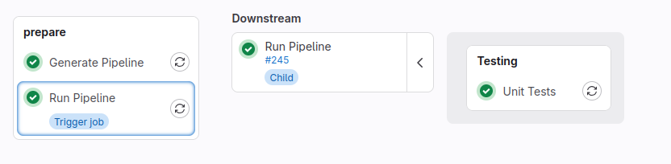

# Best Practices
The following discusses some basic techniques and approaches you may want to consider when using *spycilab*.

## Split Pipeline into multiple Files
If your pipeline gets too complex you should split it into multiple python files.
For example, you can declare all variables in a separate file like so:
```python
# file: ci_variables.py
from spycilab import VariableStore, Variable
class CustomVariableStore(VariableStore):
    """
    Use a dedicated class so IDEs can detect declared variables when importing this from another file (autocomplete).
    """
    def __init__(self):
        super().__init__()
        self.A = Variable(description="This is variable A")
        # ... add more variables here

Variables = CustomVariableStore()

# file: pipeline.py
from ci_variables import Variables

def some_job_work():
    print(f"A is : {Variables.A}")
```

## Generic Jobs (Parameterization)
Let's say we want to have multiple jobs *"Deploy to X"*, with *X* being the target to deploy some application to.
We can write a job creator function and call it for each target. 
```python
from spycilab import Job, JobStore, JobConfig
Jobs = JobStore()
targets = ["Puma", "Tiger", "Lion"]

def work_deploy(x: str):
    print(f"deploying to {x} ...")
    return True

def add_deploy_job(x: str):
    Jobs.add(f"deploy_to_{t.lower()}", Job(
        f"Deploy to {t}",
        JobConfig(work=lambda: work_deploy(x))))

for t in targets:
    add_deploy_job(t)
```
You might be tempted to create the job directly in the for loop, like so:
```python
def work_deploy(x: str):
    print(f"deploying to {x} ...")
    return True
    
for t in targets:
    # Don't do this! t is used as reference, so all jobs will use the same parameter value ('Lion')
    Jobs.add(f"deploy_to_{t.lower()}", Job(f"Deploy to {t}", JobConfig(work=lambda: work_deploy(t))))
```
This will not work as expected, because `t` is used as reference. So in this case all your jobs will do exactly the same thing, printing: `deploying to Lion ...`

In conclusion: For parameterized jobs, always wrap the job creation in a function that receives all parameters needed for the job execution.

##  Updating `.gitlab-ci.yml` (generate)
When changing your pipeline, you always need to `./pipeline.py generate` and commit the resulting `.gitlab-ci.yml` so the changes are actually seen by GitLab.
It is quite easy to forget to generate the new yaml, so you may want to use one of the following workarounds.

### Git Pre-Commit Hook
You can setup a git pre-commit hook that automatically generates and adds the newly generated `.gitlab-ci.yml` when
committing changes.
Put the following script in a file in `/<repo-root>/.git/hooks/pre-commit` and make it executable (`sudo chmod +x <file>`)
```bash
#!/bin/sh
# Pre-Commit
# Generate pipeline YAML and add to commit
set -e
./pipeline.py generate
git add .gitlab-ci.yml
```
Personally, I find this to be the best solution (hence it is listed first).
However, one drawback of this approach is that each developer of the project has to install this hook manually.

### Pipeline Check Job
Another way to detect an outdated pipeline YAML is to simply add a job to the pipeline that generates it and compares it to the checked-in version.
```python
#!/usr/bin/env python3
# pipeline.py
from spycilab import StageStore, Stage, JobStore, Job, JobConfig
import subprocess

stages = StageStore()
stages.prepare = Stage("Prepare")

def work_pipeline_check() -> bool:
    """
    Check whether generated pipeline yml is up-to-date.
    :return: True on success.
    """
    def load_yml():
        with open(".gitlab-ci.yml", "r") as f:
            return f.read()
    current_gitlab_yml = load_yml()
    # yes, the script is running itself again
    subprocess.run([f"./pipeline.py", "generate"], check=True)
    new_gitlab_yml = load_yml()
    if current_gitlab_yml != new_gitlab_yml:
        print("Generated file differs from checked-in.\n"
              "Please run './pipeline.py generate' and commit the new .gitlab-ci.yml")
        return False

    return True

jobs = JobStore()
jobs.pipeline_check = Job("Check Pipeline", JobConfig(stage=stages.prepare, work=work_pipeline_check))
```
Although this prevents you from merging an outdated YAML to the main branch (when merging via GitLab), it still requires you to manually run `./pipeline generate` at some point.

Of course, you could extend the job to commit the new YAML automatically in the pipeline.
However, making automatic commits in the pipeline comes with a whole bag of other problems.

### Dynamic YAML Generation (Child Pipeline)
Instead of checking-in the generated yml you can also dynamically generate it in the GitLab pipeline.
All you need is a fixed bootstrap pipeline.
```yaml
# .gitlab-ci.yml
# generate actual pipeline with spycilab and run as child pipeline
stages:
  - "Prepare"

Generate Pipeline:
  stage: "Prepare"
  script: ./pipeline.py generate --output spycilab.gitlab-ci.yml
  artifacts:
    paths:
      - spycilab.gitlab-ci.yml
  
Run Pipeline:
  stage: "Prepare"
  needs:
    - Generate Pipeline
  trigger:
    strategy: depend
    include:
      - artifact: spycilab.gitlab-ci.yml
        job: Generate Pipeline
```
The drawback of this approach is that the actual pipeline will always be hidden inside the downstream trigger job, so extra clicks are required in the web interface to see all the jobs of the pipeline.


